<div align="center" dir="rtl">

# 🦁 XXD Shop 006 | عرض الأقمشة والخامات

### اعرف أولاً ما هذا القماش حقاً، ثم دع الناس يلمسونه عبر الشاشة

<a href="README.md">简体中文</a> · <a href="README.en.md">English</a> · <a href="README.ja.md">日本語</a> · <a href="README.ko.md">한국어</a> · <strong>العربية</strong>

</div>

**اكتشف أولاً حقيقة هذا القماش، ثم اصنع صورة تتيح للمتسوقين الإحساس به عبر الشاشة.**
لا جيرسيه عادياً يُرسم كأنه حرير، ولا اسم تقنية لعلامة يُرسم بنيةً غير موجودة.

| بنظرة واحدة | |
|---|---|
| **ما تعطيه** | صورة القماش أو الملبس (مطلوبة) ووصف القماش (الاسم والتركيب والتشطيب ونقاط البيع)؛ والورقة الفنية أفضل |
| **ما تحصل عليه** | صور أقمشة لصفحات التفاصيل تُظهر الخامة الأساسية كبيرة، مع أقل قدر من الوسوم المهنية عند الحاجة |
| **ملامح الأسلوب** | ألياف وغرز حقيقية · ضوء مائل يبرز البروز · خلفية نظيفة · بضعة خطوط إشارة رفيعة |
| **الأنسب لـ** | الملابس ومعدات الأنشطة الخارجية والمنسوجات المنزلية والحقائب التي تحتاج صفحاتها إلى شرح القماش |

> **بعد التثبيت، قل فقط:**
>
> /xxd-shop-006 هذا غلاف مصفّح من 3 طبقات: XX-Tex 3L، وجه نايلون 40D، DWR — اصنع صورة القماش

<!-- xxd-samples:start -->
## نماذج

<p align="center"><a href="assets/examples/s01-size-1x1-1254x1254.png">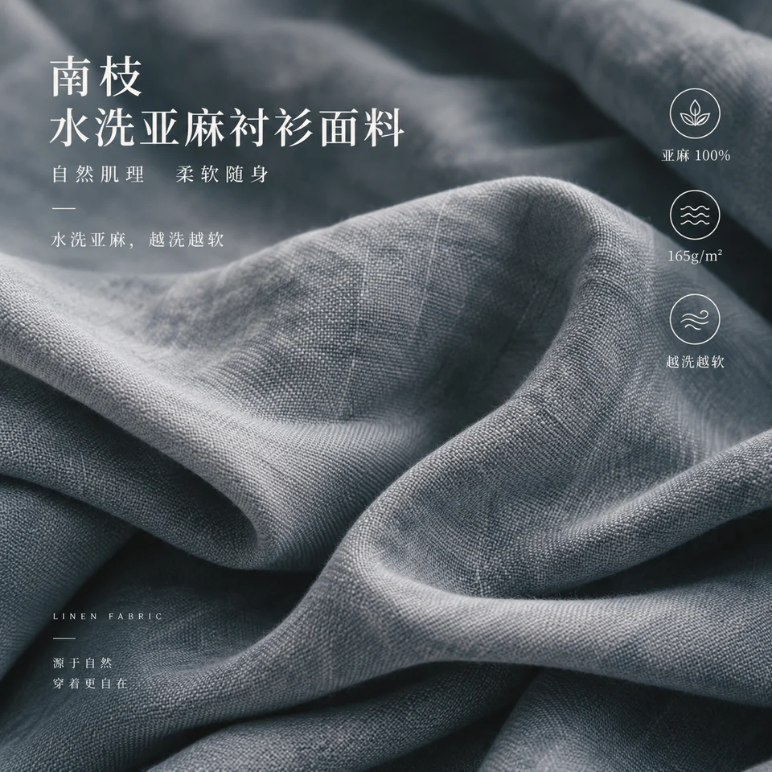</a><br><sub>وحدة القماش في صفحة التفاصيل · 1:1 · 1254x1254<br>قماش قمصان من الكتان المغسول من NANZHI · <a href="assets/examples/sources/fabric-linen.jpg">صورة أصلية</a> + <a href="assets/examples/sources/logo-nanzhi.png">Logo</a> · خطة نصوص (الصينية)</sub></p>

### منتج واحد لكل موضع عرض

المنتج نفسه والأسلوب نفسه: لكل نسبة تكوين جديد، لا قصّ.

<table>
<tr><td align="center" valign="top"><a href="assets/examples/s01-size-1x1-1254x1254.png"></a><br><sub>وحدة القماش في صفحة التفاصيل · 1:1 · 1254x1254<br>قماش قمصان من الكتان المغسول من NANZHI · <a href="assets/examples/sources/fabric-linen.jpg">صورة أصلية</a> + <a href="assets/examples/sources/logo-nanzhi.png">Logo</a> · خطة نصوص (الصينية)</sub></td><td align="center" valign="top"><a href="assets/examples/s02-size-3x4-1086x1448.png">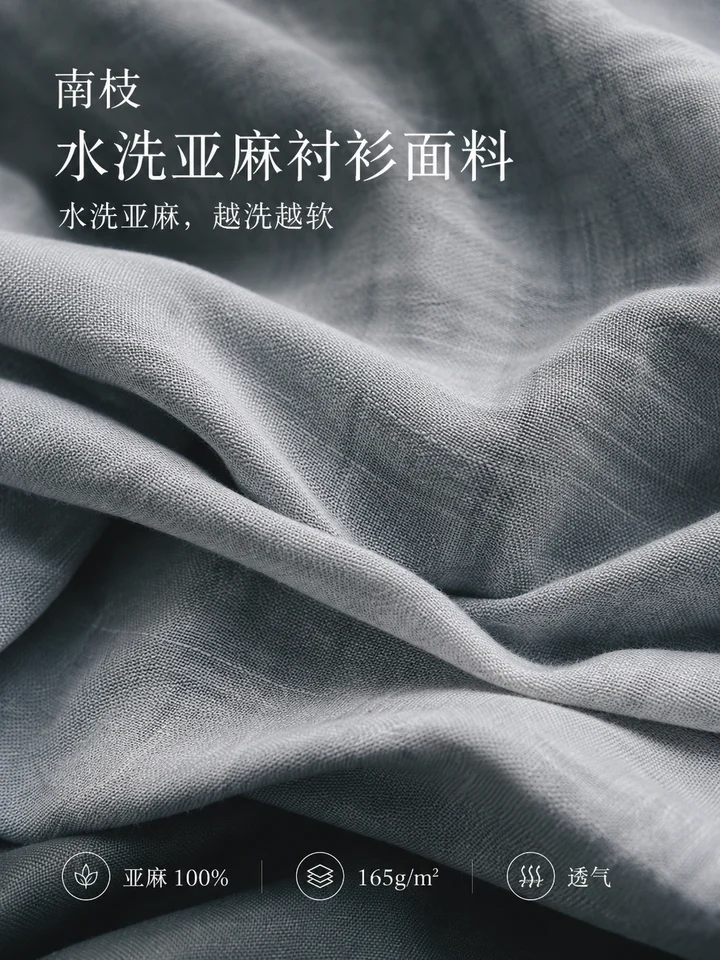</a><br><sub>صفحة التفاصيل · 3:4 · 1086x1448<br>قماش قمصان من الكتان المغسول من NANZHI · <a href="assets/examples/sources/fabric-linen.jpg">صورة أصلية</a> + <a href="assets/examples/sources/logo-nanzhi.png">Logo</a> · خطة نصوص (الصينية)</sub></td><td align="center" valign="top"><a href="assets/examples/s03-size-9x16-941x1672.png">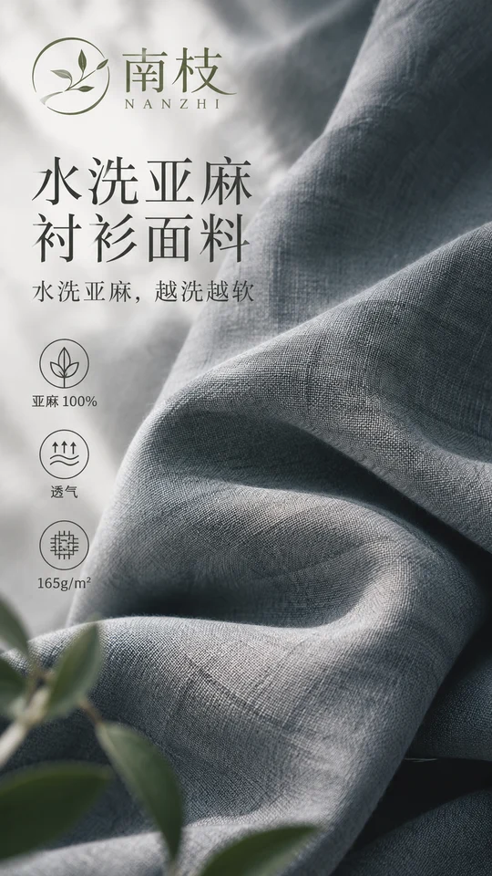</a><br><sub>شاشة عمودية · 9:16 · 941x1672<br>قماش قمصان من الكتان المغسول من NANZHI · <a href="assets/examples/sources/fabric-linen.jpg">صورة أصلية</a> + <a href="assets/examples/sources/logo-nanzhi.png">Logo</a> · خطة نصوص (الصينية)</sub></td><td align="center" valign="top"><a href="assets/examples/s04-size-16x9-1672x941.png">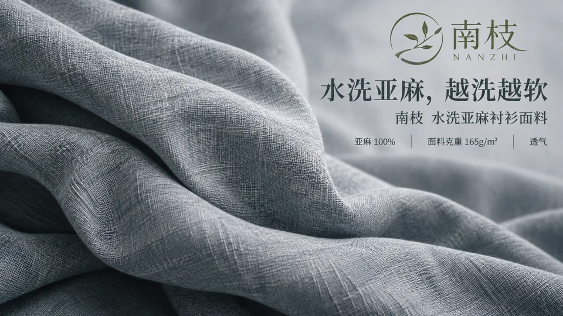</a><br><sub>شريط إعلاني · 16:9 · 1672x941<br>قماش قمصان من الكتان المغسول من NANZHI · <a href="assets/examples/sources/fabric-linen.jpg">صورة أصلية</a> + <a href="assets/examples/sources/logo-nanzhi.png">Logo</a> · خطة نصوص (الصينية)</sub></td></tr>
</table>

### يصلح لفئات مختلفة أيضاً

<table>
<tr><td align="center" valign="top"><a href="assets/examples/c01-category-3x4-1086x1448.png">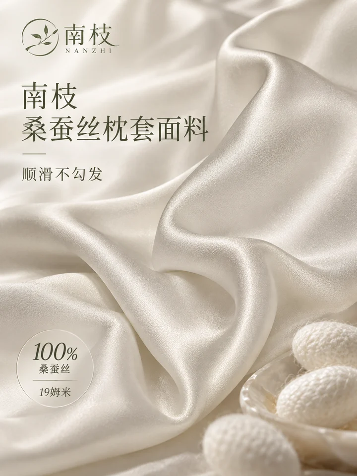</a><br><sub>وحدة القماش في صفحة التفاصيل · 3:4 · 1086x1448<br>قماش كيس الوسادة من حرير التوت من NANZHI · <a href="assets/examples/sources/fabric-silk.jpg">صورة أصلية</a> + <a href="assets/examples/sources/logo-nanzhi.png">Logo</a> · خطة نصوص (الصينية)</sub></td><td align="center" valign="top"><a href="assets/examples/c02-category-1x1-1254x1254.png">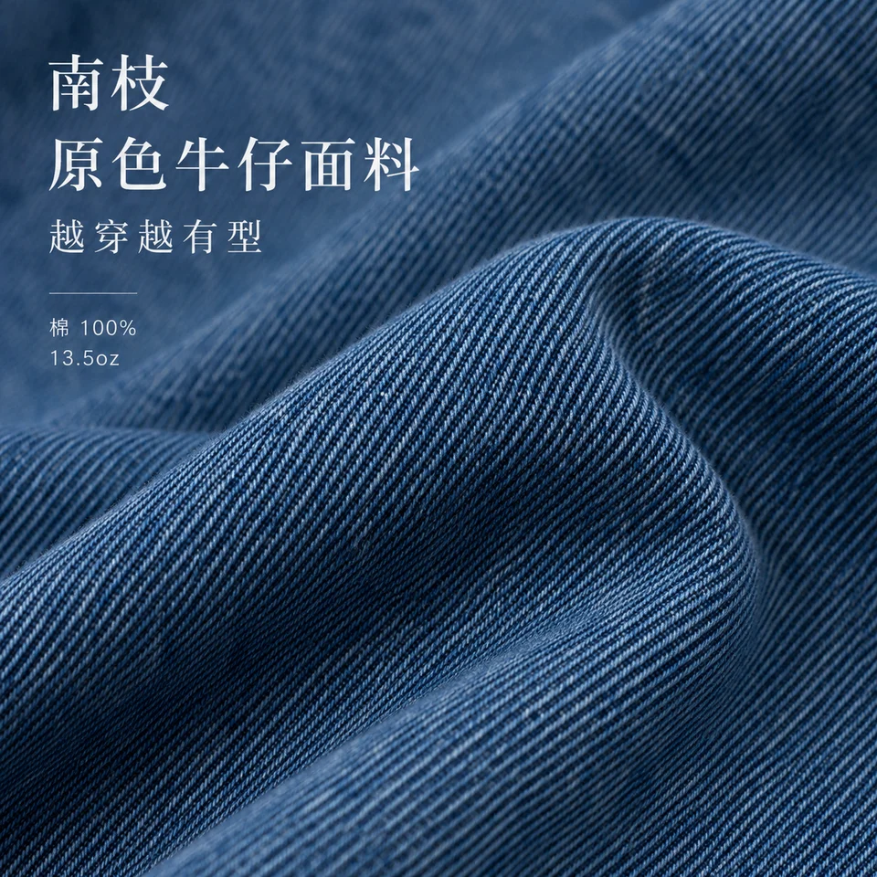</a><br><sub>وحدة القماش في صفحة التفاصيل · 1:1 · 1254x1254<br>قماش دنيم خام من NANZHI · <a href="assets/examples/sources/fabric-denim.jpg">صورة أصلية</a> + <a href="assets/examples/sources/logo-nanzhi.png">Logo</a> · خطة نصوص (الصينية)</sub></td><td align="center" valign="top"><a href="assets/examples/c03-category-4x5-1122x1402.png">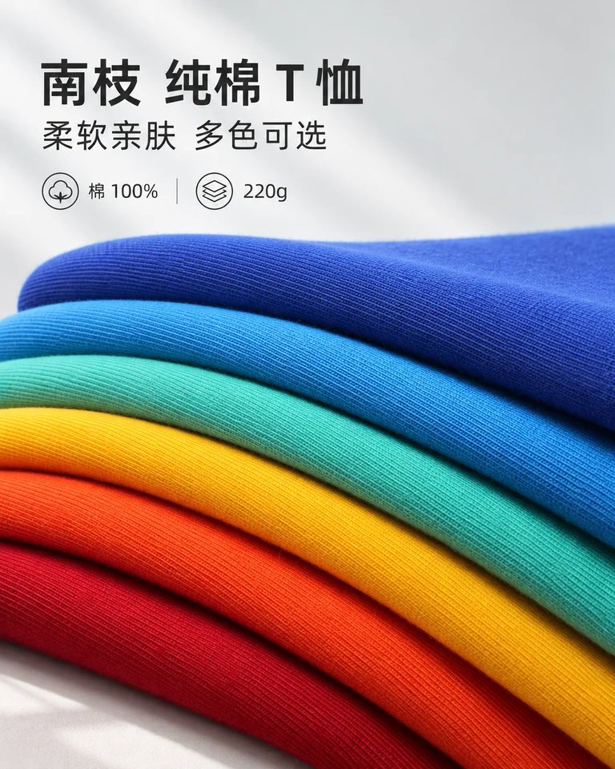</a><br><sub>صفحة التفاصيل · 4:5 · 1122x1402<br>تيشيرت قطني من NANZHI · <a href="assets/examples/sources/cotton-tees.jpg">صورة أصلية</a> + <a href="assets/examples/sources/logo-nanzhi.png">Logo</a> · خطة نصوص (الصينية)</sub></td></tr>
<tr><td align="center" valign="top"><a href="assets/examples/s05-category-3x4-1086x1448.png">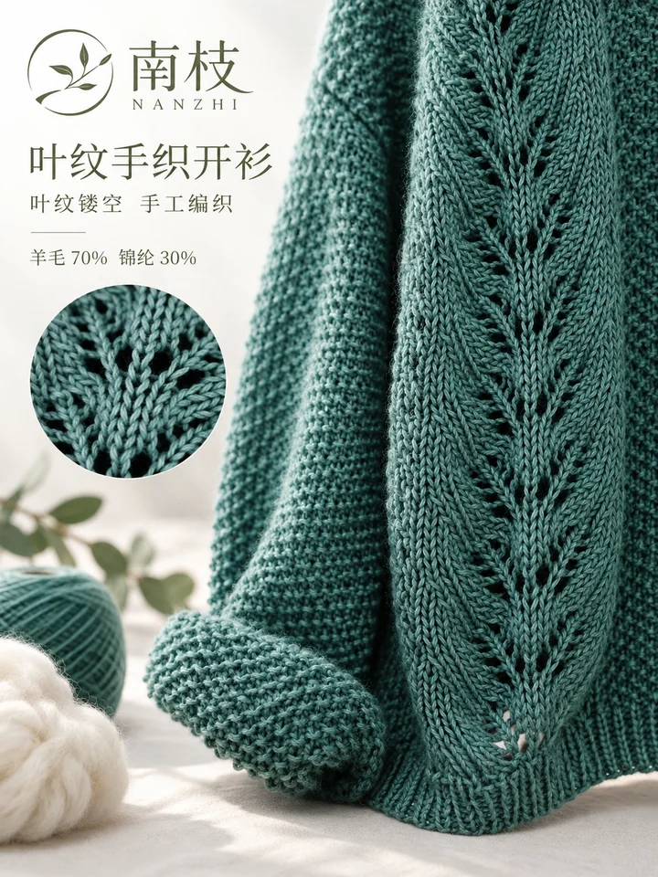</a><br><sub>صفحة التفاصيل · 3:4 · 1086x1448<br>كارديغان محبوك يدوياً بنقشة أوراق من NANZHI · <a href="assets/examples/sources/knit-cardigan.jpg">صورة أصلية</a> + <a href="assets/examples/sources/logo-nanzhi.png">Logo</a> · خطة نصوص (الصينية)</sub></td><td align="center" valign="top"><a href="assets/examples/s06-category-4x5-1122x1402.png">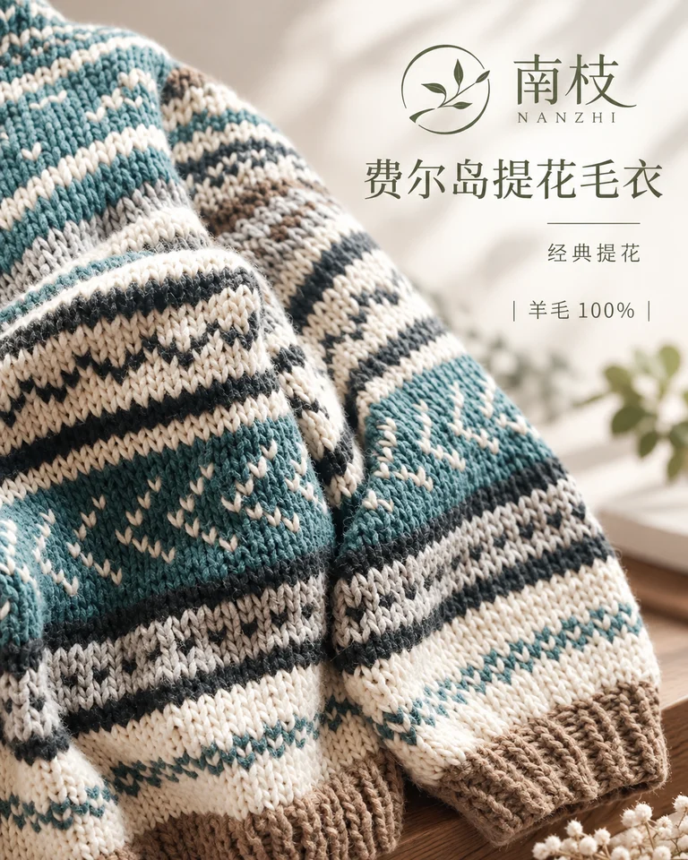</a><br><sub>منشور على وسائل التواصل · 4:5 · 1122x1402<br>سترة بنقشة فير آيل من NANZHI · <a href="assets/examples/sources/knit-fairisle.jpg">صورة أصلية</a> + <a href="assets/examples/sources/logo-nanzhi.png">Logo</a> · خطة نصوص (الصينية)</sub></td><td align="center" valign="top"><a href="assets/examples/s07-category-1x1-1254x1254.png">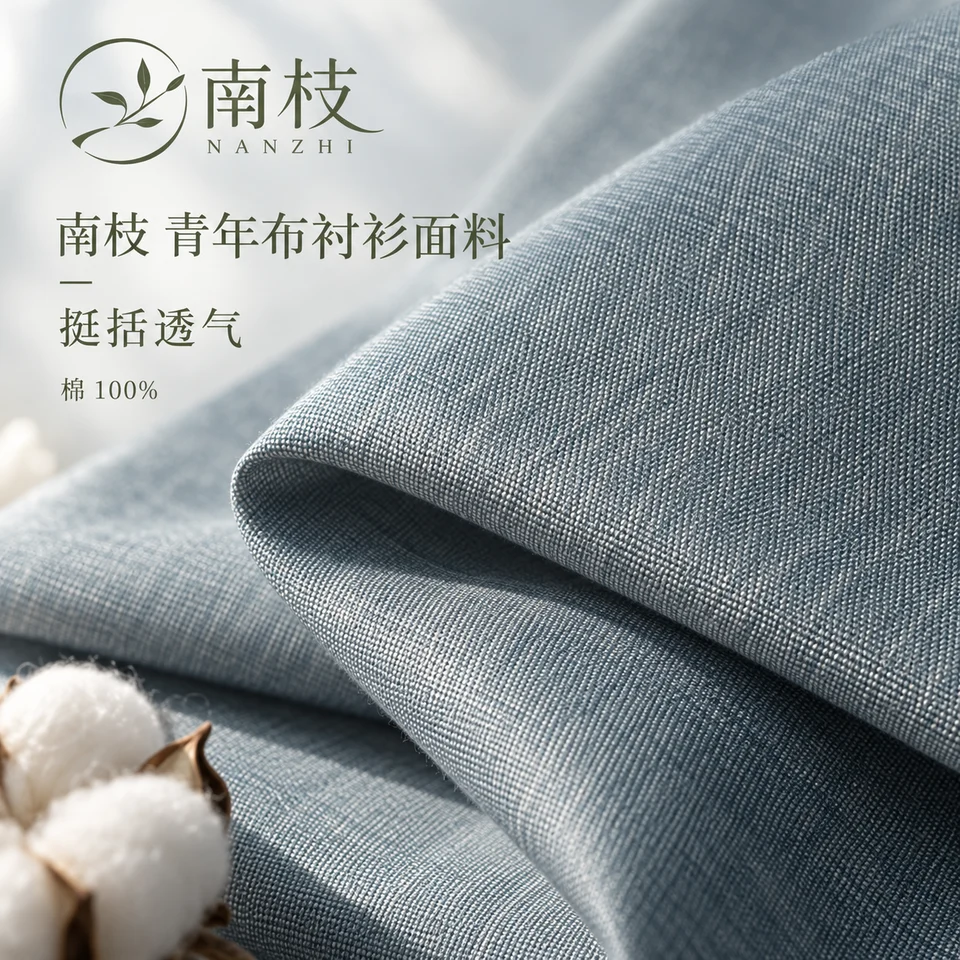</a><br><sub>وحدة القماش في صفحة التفاصيل · 1:1 · 1254x1254<br>قماش قمصان شامبريه من NANZHI · <a href="assets/examples/sources/fabric-chambray.jpg">صورة أصلية</a> + <a href="assets/examples/sources/logo-nanzhi.png">Logo</a> · خطة نصوص (الصينية)</sub></td></tr>
</table>

### بالإنجليزية

<table>
<tr><td align="center" valign="top"><a href="assets/examples/s08-special-3x4-1086x1448.png">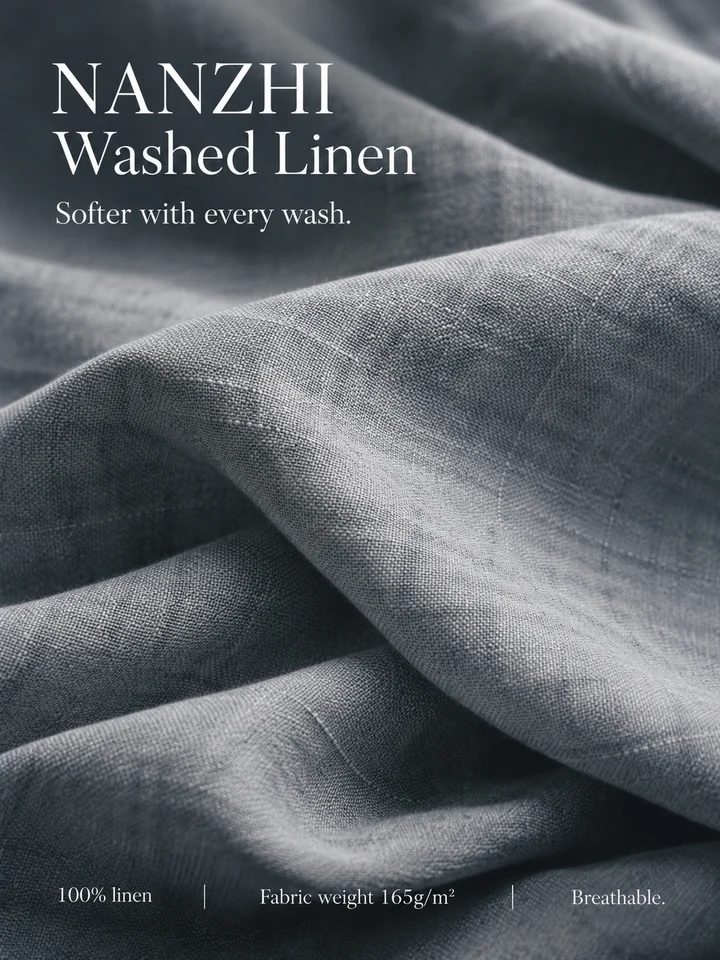</a><br><sub>صفحة التفاصيل · 3:4 · 1086x1448<br>قماش قمصان من الكتان المغسول من NANZHI · <a href="assets/examples/sources/fabric-linen.jpg">صورة أصلية</a> + <a href="assets/examples/sources/logo-nanzhi.png">Logo</a> · خطة نصوص (الإنجليزية)</sub></td></tr>
</table>

<sub>كل منتجات النماذج علامات تجريبية خيالية، والأسعار والمواصفات أرقام تجريبية. صور المنتجات والشعارات التجريبية صُنعت لهذا المشروع، وبعضها مبني على صور من Unsplash؛ الإسناد والترخيص في [assets/examples/README.md](assets/examples/README.md). كل صورة ناتج توليد واحد كامل، بلا تنقيح أو تركيب أو تكبير، مع مقاسها الحقيقي بالبكسل. الصور التي لم تجتز المراجعة البصرية أُعيد توليدها ولا تظهر هنا. انقر لعرض الحجم الكامل.</sub>

<!-- xxd-samples:end -->

## ما المشكلة التي يحلها

«صورة القماش» في صفحة الملابس كثيراً ما تكون لقطة قريبة جميلة لقماش لا علاقة كبيرة له بالقطعة الفعلية: جيرسيه عادي مرسوم بلمعان الحرير، واسم تقنية لعلامة مرسوم بنيةً غير موجودة.

هدف هذا الأسلوب ليس «صورة قماش جميلة» بل **صورة دقيقة لقيمة الخامة التي تجعل هذا المنتج جديراً بالشراء**. لذلك يضيف **Shop 006** خطوة قبل الرسم: **البحث**.

## البحث أولاً، ثم الصورة

1. يلتقط المصطلحات غير المألوفة أو الملتبسة من اسم القماش وتركيبه وتشطيبه ونقاط بيعه التي تعطيها.
2. يتحقق منها في مصادر العلامة والمصنّع وصناعة النسيج والمعايير ليصنّف كلاً منها: ليف، غزل، نسج، حياكة، تصفيح، معالجة سطحية، تشطيب، تقنية وظيفية — أو مجرد اسم تجاري.
3. يفصل بين «ما هي الخامة» و«ما قد تفعله عملية ما» و«ما تدّعيه العلامة». الادعاءات بلا سند لا تُرسم علماً أبداً.
4. يكتب النتائج، كلاً بمصدرها، في `facts.md` داخل مجلد المهمة لتتحقق منها.
5. ثم يختار كيف يُظهر القيمة الأساسية: لقطة مكبّرة للنسج، وطيات وضوء جانبي للنعومة، ومسام للتهوية، وقطرات مقنعة لطرد الماء، ومقطع بسماكة حقيقية للعزل.

## ما تحضّره

- **صورة القماش أو الملبس** (مطلوبة): اللون والنقشة والنسج ومقياس الملمس تتبعها.
- **وصف القماش** (مطلوب): الاسم والتركيب والتشطيب والبنية والوظيفة ونصوص البيع — كلما كان أكمل كان أفضل.
- **مستنداتك الخاصة** (اختيارية): يمكن تقديم الأوراق الفنية للمصنّع وتقارير الاختبار مباشرة، ولا تُرسل أبداً إلى بحث خارجي.

## طريقة الاستخدام

### الخطوة 1: التثبيت (مرة واحدة)

```bash
git clone https://github.com/nevertoday/xxd-shop-006.git
mkdir -p ~/.claude/skills
ln -s "$(pwd)/xxd-shop-006" ~/.claude/skills/xxd-shop-006
```

مستخدمو Codex يربطون المجلد نفسه بـ `~/.codex/skills/xxd-shop-006`. أعد تشغيل جلسة مساعدك الذكي بعد التثبيت.

### الخطوة 2: قل ما تريد بكلمات بسيطة

```text
/xxd-shop-006 هذا غلاف مصفّح من 3 طبقات: XX-Tex 3L، وجه نايلون 40D، DWR — اصنع صورة القماش
/xxd-shop-006 كشمير 100%، جيرسيه عيار 12 — الخامة فقط، بلا نص
/xxd-shop-006 تريكو مبرّد، الورقة الفنية مرفقة — اصنع صورة 3:4 لمزايا القماش
```

لا معاملات لتحفظها. كل ما تتركه مفتوحاً، كالمقاسات أو العدد، يُسأل عنه مرة واحدة، ويمكنك في المرة التالية إعادة استخدام إعداداتك السابقة.

### الخطوة 3: ما يفعله بعد ذلك

1. يقرأ صورة منتجك ووصفه ولا يسأل إلا عمّا بقي مفتوحاً؛ وتُقترح المقاسات من الاستخدام مع أبعادها بالبكسل.
2. يبحث أولاً في مصطلحات القماش ويكتب النتائج بمصادرها في `facts.md`.
3. إن لم تعطِ نصوصاً، يكتب مسودة الوسوم من النتائج الموثقة فقط، ويولّد بعد تأكيدك.
4. يُكوَّن كل مقاس من جديد، ولا يُقصّ أبداً من صورة أخرى.
5. يفحص كل صورة قبل التسليم: هل المنتج دون تغيير، وهل النص مكتوب صحيحاً، وهل توجد أرقام لم تعطها؟ وما يفشل يُبلَّغ عنه ويُعاد.
6. يحفظ ملفات PNG في مجلد مهمة جديد تحت `~/Desktop/xxd/xxd-shop-006/` ويعطيك المسار.

<details>
<summary><strong>متقدم: معاملات الأوامر (لاحقاً)</strong></summary>

```text
/xxd-shop-006 ./shell-jacket-fabric.jpg --product "3-layer laminated shell, XX-Tex 3L, 40D nylon face, DWR" --size 3:4 --locale en-US
/xxd-shop-006 ./cashmere-detail.jpg --product "100% cashmere, 12-gauge jersey" --size 1:1 --text none
```

المعاملات الرئيسية: `--product` (مواصفات القماش) و`--facts` (بياناتك) و`--size` و`--text prompt / exact / plan / none` و`--locale`. القائمة الكاملة في [مرجع التشغيل](references/shop-runtime.md).

</details>

## الأسئلة الشائعة

**ماذا لو لم يستطع مساعدي الذكي البحث في الويب؟**

يخبرك أولاً، ثم لا يستخدم إلا مستنداتك وما يظهر في الصورة؛ والمصطلحات غير الموثقة تبقى خارج الصورة.

**هل يمكن الاستغناء عن الوسوم؟**

نعم — اطلب بلا نص وستحصل على صورة خامة خالصة.

**ماذا أحتاج؟**

ثلاثة أشياء: ① مساعد ذكي يدعم الـ Skills، مثل Claude Code أو Codex؛ ② نموذج قادر على توليد الصور — توليد الصور المدمج في مساعدك، أو مزوّد نماذج مُعدّ في Codex يولّد الصور عبر Responses API (افتراضياً GPT Image 2)؛ ③ Python 3.11 أو أحدث مع Pillow (`pip install pillow`).

**هل له تكلفة؟ وهل يمكنني استخدامه تجارياً؟**

تنزيل الـ Skill مجاني؛ وتكلفة توليد الصور تُحتسب على حساب النموذج الخاص بك. صنع صور لمنتجاتك أو متجرك أو علامتك (أو لصاحب عملك بصفتك موظفاً) مسموح تجارياً دون طلب إذن؛ أما إعادة بيع الـ Skill أو تحويله إلى خدمة مدفوعة أو صنع صور للآخرين بمقابل فيحتاج أولاً إلى إذن كتابي من المؤلف. راجع قسم «الترخيص» في النهاية.

**ما حجم الصور؟**

يمكنك طلب نسبة أو بكسلات محددة. الحجم الحقيقي هو ما يعيده النموذج — دون تكبير سري أبداً — واسم الملف يذكر البكسلات الحقيقية.

**هل سيحتوي النص في الصورة على أخطاء إملائية؟**

صور الذكاء الاصطناعي تخطئ أحياناً في الكلمات أو تضيف علامات صغيرة مثل ® بجوار اسم العلامة. تُكبَّر كل صورة وتُفحص قبل التسليم، وأي فشل يُعاد؛ وكل النماذج في هذه الصفحة اجتازت ذلك الفحص.

**هل سيختلق أسعاراً أو أرقام مبيعات؟**

لا. كل ما يبدو حقيقة — السعر والمواصفات والمنشأ والمبيعات والجوائز والشهادات — يأتي فقط مما تقدمه أو من نص مقروء بوضوح على المنتج؛ وإلا يُترك، بلا عنصر نائب «¥XX».

**هل يتعامل مع منتجات كثيرة دفعة واحدة؟**

نعم. أعطه مجلداً من صور المنتجات: كل صورة منتج واحد، ويُسأل عن المقاسات والنص مرة واحدة، ولا تتسرب حقائق أي منتج أو نصوصه إلى غيره.

## المبادئ

- **يبقى الأسلوب وفياً لأصله:** خلف هذا الـ Skill موجّه تصميم تجاري ناضج ([الموجّه الأصلي](references/original-prompt/zh-CN.md) · [ترجمة إنجليزية للاطلاع](references/original-prompt/en.md)). لا يعيد الـ Skill كتابته ولا يضيف ألوانه أو توجيهه الفني الخاص؛ بل يسلّم النموذج منتجك ومقاساتك ونصك وحقائقك فقط.
- **لا يُعاد تصميم المنتج:** مع صورة المنتج، يتبع الشكلُ واللونُ ونصُ العبوة والشعارُ الصورةَ.
- **حقائقك وحدها،** وكل منتج قائم بذاته — لا شيء مستعار من منتجات أخرى أو نتائج سابقة أو نماذج.
- **صور PNG نقطية حقيقية،** لا SVG ولا رسوم بالكود تُقدَّم على أنها صور؛ وكل تشغيل ينشئ مجلد مهمة جديداً.
- كل وسم على الصورة يعود إلى `facts.md` أو إلى مستنداتك.

<!-- xxd-shop-tail -->
<details>
<summary><strong>بنية المشروع (للمطوّرين)</strong></summary>

```text
xxd-shop-006/
├── SKILL.md
├── README.md / README.en.md / README.ja.md / README.ko.md / README.ar.md
├── LICENSE
├── agents/openai.yaml
├── assets/examples/
├── scripts/
│   ├── configured_imagegen.py
│   ├── clean_marks.py
│   └── shop_preferences.py
└── references/
    ├── shop-runtime.md
    ├── runtime-preferences.md
    ├── sample-workflow.md
    └── original-prompt/
        ├── README.md
        ├── zh-CN.md
        └── en.md
```

</details>

<!-- xxd-readme-ads:start -->
## عن XXD

XXD هو اختصار اسم علامة Xiaoxiaodong. أنشأ هذا المشروع ويديره [@xiaoxiaodong01](https://x.com/xiaoxiaodong01).

## عضوية Xiaoxiaodong متعددة المنصات · 699 يواناً صينياً سنوياً

> **إفصاح إعلاني:** رمز QR وروابط العضوية والخدمات المدفوعة أدناه معلومات ترويجية من XXD. المسح أو الشراء اختياري تماماً ولا يؤثر في استخدام المشروع المفتوح المصدر.

تفتح عضوية سنوية واحدة ثلاث مزايا معاً: **Knowledge Planet + مكتبة توجيهات أعضاء XXD + عضوية جميع Skills من مستوى General**. المزايا الثلاث ضمن عضوية واحدة ولا يلزم شراء منفصل.

<!-- xxd-shop-command-system:start -->

### كيف تتعاون الـ Skills

| المستوى | ما يتضمنه | المهمة |
|---|---|---|
| **General** | `xxd-shop-all` | يكتشف Skills المرقمة المتاحة، ويرشحها حسب المنتج وموضع العرض والاحتياج البصري، وينظم المهام متعددة الأساليب والدفع بالجملة. |
| **Soldier** | `xxd-shop-NNN` | تنفذ كل مهارة مرقمة موجّهها الأصلي وجماليتها الخاصة، وتنجز المهمة المحددة التي يوزعها General. |

<!-- xxd-shop-command-system:end -->

### ماذا تحصل عليه

1. **استشارات فردية عبر WeChat لتعلّم الذكاء الاصطناعي والمشاريع**
   أضف Xiaoxiaodong على WeChat عبر رمز QR أدناه للتواصل الفردي حول تعلّم الذكاء الاصطناعي والأدوات والمشاريع العملية والحصول على إرشادات وإجابات مفيدة. يمكن تنظيم الأسئلة المميزة ضمن محتوى الأعضاء.
2. **مكتبة توجيهات للأعضاء تتوسع باستمرار**
   تضم [مكتبة توجيهات أعضاء XXD](https://vip.xiaoxiaodong.ai/) حالياً نحو 32 ألف توجيه، وستواصل التنظيم والتوسع بهدف تجاوز 100 ألف.
3. **جميع Skills من مستوى General ودعم الاستخدام**
   تغطي عضوية واحدة جميع Skills من مستوى General، مع إرشادات ودعم للأسئلة عند الحاجة.
4. **أولوية للطلبات شديدة الاحتياج**
   تُراجع التوجيهات والـ Skills ذات الطلب المرتفع والاحتياج الفعلي وتُطوّر أولاً حيثما كان ذلك مناسباً.

### كيفية الاشتراك

- [فعّل العضوية ذاتياً من موقع الأعضاء](https://vip.xiaoxiaodong.ai/).
- أو امسح رمز QR أدناه لإضافة Xiaoxiaodong على WeChat والحصول على دعم فردي للتفعيل.

<p align="center"><a href="https://xiaoxiaodong.pages.dev/assets/wechat-qr.png"></a></p>
<!-- xxd-readme-ads:end -->

## الترخيص

يُقدَّم هذا المشروع — بما في ذلك Skill والموجّهات والبرامج النصية والوثائق والعينات المرفقة — بموجب **PolyForm Noncommercial License 1.0.0**، مع إذن إضافي «للاستخدام في نشاطك التجاري الخاص» في أول ملف [LICENSE](LICENSE). النص القانوني الكامل موجود في [LICENSE](LICENSE)، والصفحة الرسمية هي <https://polyformproject.org/licenses/noncommercial/1.0.0>.

بكلمات واضحة:

- **مجاني للبائعين لاستخدامهم الخاص:** يمكنك استخدامه لصنع صور لمنتجاتك أو متجرك أو علامتك، أو لصاحب عملك بصفتك موظفاً، ويمكنك تعديل Skill لهذا الغرض. ويمكن استخدام الصور تجارياً (عرض المنتجات والإعلانات والتغليف) دون طلب إذن.
- يُسمح بالاستخدام الشخصي للدراسة والبحث والتجربة والاختبار والهوايات والترفيه الخاص. ويُسمح أيضاً باستخدامه من الجمعيات الخيرية والمؤسسات التعليمية ومنظمات البحث أو السلامة أو الصحة العامة ومنظمات حماية البيئة والمؤسسات الحكومية.
- لأغراض **غير تجارية**، يمكنك النسخ والتعديل وإنشاء أعمال مشتقة ومشاركة المشروع. عند المشاركة، أرفق هذا الترخيص (مع الإذن الإضافي) وكل سطر `Required Notice:` فيه.
- **تحتاج الاستخدامات التالية إلى ترخيص تجاري كتابي منفصل:** إعادة بيع Skill أو الموجّهات أو نسخها المعدّلة أو توزيعها بمقابل؛ تحويلها إلى أداة مدفوعة أو خدمة عبر الإنترنت أو API؛ صنع صور للآخرين بمقابل (الاستوديوهات والوكالات وإدارة المتاجر والعمل الحر)؛ استخدامها مادةً لدورات أو تدريب مدفوع. تواصل عبر [@xiaoxiaodong01](https://x.com/xiaoxiaodong01) أو رمز QR أعلاه.
- يمنح الترخيص حقوق النشر وحقوق براءة الاختراع المحدودة المذكورة فقط. لا يمنح حقوق العلامات التجارية أو أسماء العلامات أو أي حقوق أخرى غير منصوص عليها، ولا يجوز إعادة ترخيصه أو نقل ترخيصك.
- عند تلقي إخطار كتابي بالمخالفة، لديك 32 يوماً للامتثال الكامل واتخاذ خطوات عملية للتصحيح؛ وإلا تنتهي التراخيص. كما ينهي الادعاء الكتابي بانتهاك براءة اختراع ترخيص البراءة.
- يُقدَّم المشروع **كما هو**، بلا ضمانات إلى الحد الذي يسمح به القانون، وتتحمل أنت مخاطر الاستخدام وأي أضرار ناتجة عنه.
